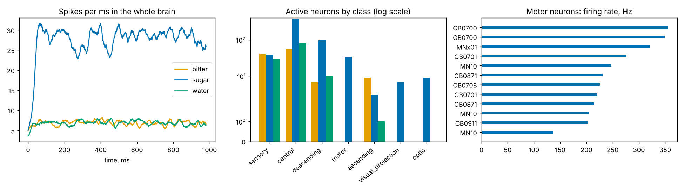

# Симуляция мозга мухи

Модель целого мозга взрослой *Drosophila melanogaster* по открытому коннектому
[FlyWire](https://flywire.ai) (138 639 нейронов, 15 млн связей между нейронами). Подход — как в статье
Shiu et al., Nature 2024: каждый нейрон — leaky integrate-and-fire, знак связи (возбуждающая/тормозная)
берётся из предсказанного нейромедиатора, а «стимул» — это сенсорные нейроны, которые спайкуют
по Пуассону.

```bash
pip install numpy scipy pandas pyarrow matplotlib
python fly/simulate.py --sub sugar bitter water --trials 3   # ~1.5 мин, данные (~105 МБ) скачаются сами
python fly/report.py                                         # fly/results/fly_brain_taste.png
```

Данные: `Connectivity_783.parquet` и `Completeness_783.csv` из репозитория
[philshiu/Drosophila_brain_model](https://github.com/philshiu/Drosophila_brain_model),
аннотации нейронов — [flyconnectome/flywire_annotations](https://github.com/flyconnectome/flywire_annotations).

## Что получилось

Вкусовые рецепторные нейроны (100 Гц, 1 с, среднее по 3 прогонам):

| стимул | рецепторов | активных нейронов | из них моторных |
|---|---|---|---|
| сахар | 32 | 587 | 34 (MN10, CB0700, MNx01…) |
| горькое | 42 | 114 | 0 |
| вода | 30 | 122 | 0 |

Сахар «разгоняет» сеть: активность расходится на сотни центральных и десятки нисходящих нейронов и доходит
до моторных нейронов хоботка (кормление), а горькое и вода затухают в первых слоях.
Это качественно совпадает с результатами оригинальной статьи.



## Ограничения

Это упрощённая модель: одни и те же параметры синапса для всех нейронов, нет электрических синапсов
и пластичности, знаки связей — предсказанные. Интерпретировать как гипотезу, не как предсказание.
