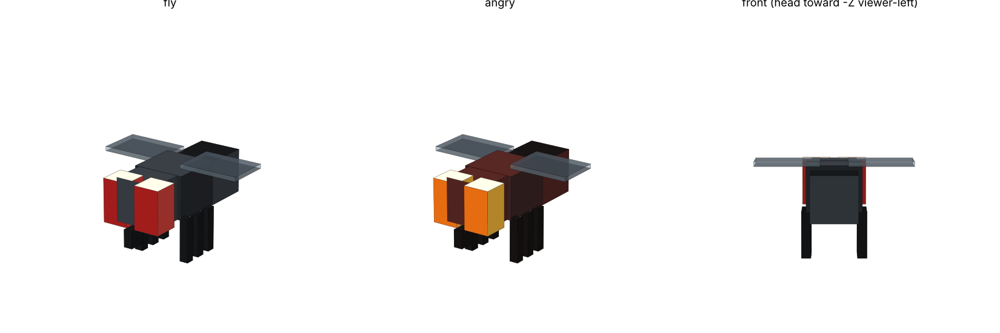

# Fly Bee — муха вместо пчелы (Minecraft Bedrock)

Ресурс-пак (аддон) для Minecraft Bedrock: новая модель **мухи** (фасеточные красные глаза, полосатое брюшко,
прозрачные крылья, шесть лапок, хоботок) подменяет модель **пчелы**. Игровая логика у пчелы остаётся прежней —
опыляет цветы, жалит, живёт в ульях, — но выглядит она как муха.

*Превью — приблизительный рендер геометрии скриптом, не скриншот из игры.*

## Как «подключено» к пчеле

`resource_pack/entity/bee.entity.json` объявляет клиентскую сущность с идентификатором `minecraft:bee` — тем же,
что у ванильной пчелы, — и ссылается на:

| файл | что делает |
|---|---|
| `models/entity/fly.geo.json` | геометрия `geometry.fly` (15 костей) |
| `textures/entity/fly/fly.png`, `fly_angry.png` | текстуры; злая пчела (`query.is_angry`) — с оранжевыми глазами |
| `animations/fly.animation.json` | взмахи крыльев (на земле почти складываются), покачивание в воздухе, брюшко, лапки, хоботок |
| `render_controllers/fly.render_controllers.json` | выбор текстуры |
| `texts/*.lang` | название «Муха» и яйцо призыва (en_US, ru_RU) |

Детёныши пчелы уменьшаются до 60%.

## Установка

1. Собери пак (готовый `FlyBee.mcpack` уже лежит рядом): `pip install pillow && python minecraft/fly_bee/build.py`.
2. Открой `FlyBee.mcpack` — Minecraft сам его импортирует (Windows, Android, iOS).
   На других платформах скопируй папку `resource_pack/` в `.../minecraft Bedrock/resource_packs/FlyBee/`.
3. Включи пак в настройках мира (раздел «Наборы ресурсов»). Пчёл в мире нет — призови: `/summon bee`.

## Что важно знать

- Я не мог запустить Minecraft в своей среде: JSON и границы UV проверены скриптом, но в игре пак не открывался.
  Если крылья машут «не в ту сторону» или модель сидит по высоте не так — правится в `build.py`
  (`BONES` и `animations()`), после чего пересобери пак.
- Пак только меняет внешний вид (ресурс-пак). Поведение пчелы не меняется.
- Модель, текстура, анимации и манифест генерируются из `build.py`: правь его, а не готовые JSON/PNG.
